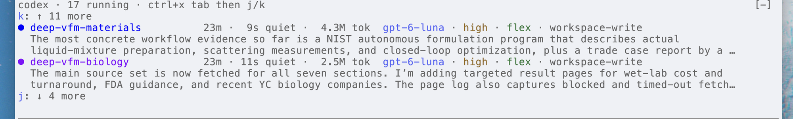

# codex-runs

A Claude Code mod that shows your live Codex CLI runs in a band above the prompt.



## What the band shows

The band shows two runs at a time. Each run has these lines:

1. The run name, the run age, the time since the last log write, and the total tokens.
2. The model, the reasoning effort, the service tier, and the sandbox mode.
3. Up to two lines of the last message from Codex. If the log has no message near its end, the band shows the last tool call.

The band lists stalled runs first, then the newest runs. A run is stalled when its log gets no write for 12 minutes. A toast tells you when a run stops. A toast also tells you when a run stalls.

## Keys

The arrow keys stay with the prompt history. To move through the runs:

1. Press `ctrl+x tab` to put the focus on the band.
2. Press `j` to move down one run. Press `k` to move up one run.
3. Press `Enter` on a run to show its full last message in a toast.
4. Press `Esc` to go back to the prompt.

## Colors

All colors come from your Claude Code theme, so they work on light and dark backgrounds. Each run gets one theme color from its process ID.

A filled red chip marks a value that you probably did not want:

- A model name that contains `astra`
- A service tier that is not `flex`
- The `danger-full-access` sandbox
- A stalled run

To change these rules, edit `detailStyle` in `hooks/register.tsx`.

If a run does not set `-m`, `model_reasoning_effort`, `service_tier`, or `--sandbox`, the band shows the value from the top of `~/.codex/config.toml`.

## Which runs the band shows

The band shows only the runs of the current Claude Code session. A run belongs to the session in one of two ways:

- The run is a child process of the Claude Code process. This is true when Claude Code starts `codex exec` in the foreground.
- A file at `~/.codex/run-owners/<pid>` holds the session ID, a tab, and a run name. `<pid>` is the process ID of the `codex` process or of one of its parent processes.

The owner file must have a write time within 60 seconds of the run start. This check stops a new run from taking an old file when the system uses a process ID again.

A detached run (`nohup ... &`) has no link to the Claude Code process. To show a detached run, write the owner file when you start the run:

```sh
nohup codex exec -m gpt-6-luna "$PROMPT" </dev/null >>"$LOG" 2>&1 &
mkdir -p ~/.codex/run-owners
printf "%s\t%s\n" "$CLAUDE_CODE_SESSION_ID" "my-run-name" > ~/.codex/run-owners/$!
```

The mod reads the session ID again at each poll. Thus the band stays correct after `/clear` or `/resume`.

## Requirements

- macOS or Linux, with `ps`, `lsof`, and `tail`
- The Codex CLI, which writes its logs to `~/.codex/sessions/`

The mod polls every 15 seconds.

## Install

At the prompt of a terminal session:

```
/plugin install codex-runs --marketplace atharva-2001/codex-subagent-panel-claude-mod
```

Type `y` to add the marketplace. Then select a scope.

From a shell:

```sh
claude plugin install codex-runs --marketplace atharva-2001/codex-subagent-panel-claude-mod
```

In the desktop app, `/plugin` does not run. Click **+** next to the prompt box, then **Plugins**. Add the marketplace `atharva-2001/codex-subagent-panel-claude-mod`, then add the plugin.

## Development

```sh
claude plugin validate .
claude plugin test .
claude --plugin-dir .
```
